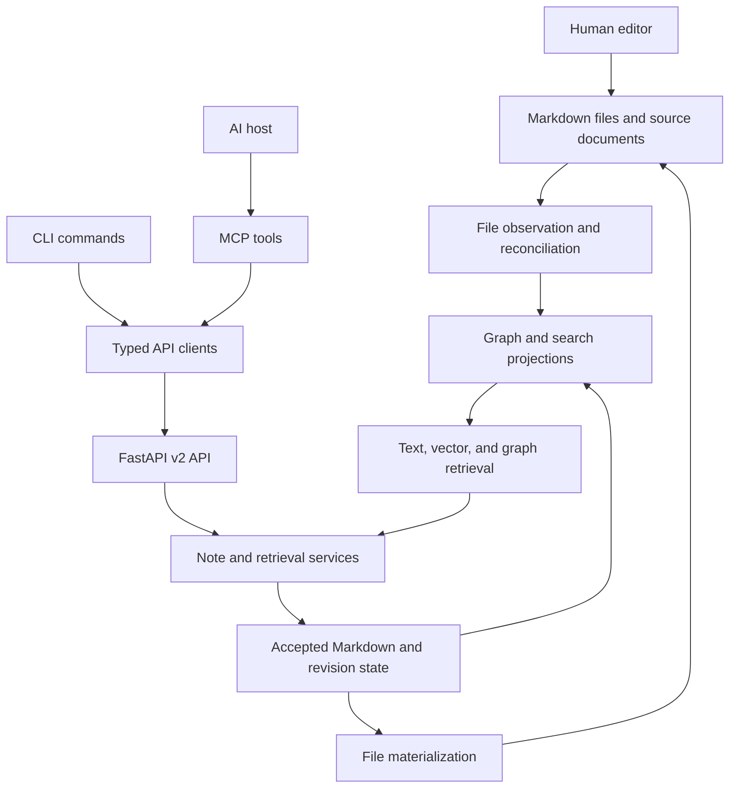

# System overview

[Collection index](README.md)

**Version scope:** this overview describes the original pinned snapshot.
The [tutorial update](17-user-tutorial.md) adds verified Basic Memory 1.0.0 workflows.

## What Basic Memory provides

Basic Memory stores durable knowledge as Markdown notes. Humans and AI clients can read and change the same notes.
The engine extracts observations and named relations. It then builds graph, text, and vector indexes.
The system exposes MCP tools, an HTTP API, and a command-line interface.

A **harness** controls an agent's lifecycle, tool access, context, and work state.
Basic Memory can supply durable knowledge to a harness. The core package does not supply a general agent execution engine.
Host packages add recall, capture, checkpoint, and resume behavior.

Evidence: [docs/DOMAIN_MODEL.md](https://github.com/basicmachines-co/basic-memory/blob/14ed21b9eaf892b7774c346898981b355fc92dbe/docs/DOMAIN_MODEL.md), [docs/ARCHITECTURE.md](https://github.com/basicmachines-co/basic-memory/blob/14ed21b9eaf892b7774c346898981b355fc92dbe/docs/ARCHITECTURE.md), and [src/basic_memory/cli/main.py](https://github.com/basicmachines-co/basic-memory/blob/14ed21b9eaf892b7774c346898981b355fc92dbe/src/basic_memory/cli/main.py).

## Snapshot

| Item | Survey value |
| --- | --- |
| Survey date | 2026-10-24, Asia/Shanghai |
| Repository | `basicmachines-co/basic-memory` |
| Commit | `14ed21b9eaf892b7774c346898981b355fc92dbe` |
| Commit date | 2026-10-23 |
| Latest release heading in the changelog | `v0.24.1`, dated 2026-10-22 |
| Required Python version | 3.12 or later |
| Production Python files | 487 |
| Production Python lines | 140,166 |
| Tracked repository files | 1,906 |
| Python files under `tests/` and `test-int/` | 653 |
| License identifier in package metadata | `AGPL-3.0-or-later` |

Counts describe this checkout. They exclude generated files and do not measure code quality.
The changelog heading does not prove which release a package registry currently serves.

Evidence: [pyproject.toml](https://github.com/basicmachines-co/basic-memory/blob/14ed21b9eaf892b7774c346898981b355fc92dbe/pyproject.toml), [CHANGELOG.md](https://github.com/basicmachines-co/basic-memory/blob/14ed21b9eaf892b7774c346898981b355fc92dbe/CHANGELOG.md), and [snapshot manifest](94-snapshot-manifest.md).

## The central architecture

Local clients can call the API in the same process through an ASGI transport.
A separate HTTP server is therefore unnecessary for normal local MCP use.
Cloud-routed projects use HTTP clients and credentials instead.

The diagram combines supported data paths. It does not imply that every path uses the same transaction or event journal.

Evidence: [src/basic_memory/mcp/async_client.py](https://github.com/basicmachines-co/basic-memory/blob/14ed21b9eaf892b7774c346898981b355fc92dbe/src/basic_memory/mcp/async_client.py), [src/basic_memory/services/note_content_writes.py](https://github.com/basicmachines-co/basic-memory/blob/14ed21b9eaf892b7774c346898981b355fc92dbe/src/basic_memory/services/note_content_writes.py), and [src/basic_memory/index/local_runtime.py](https://github.com/basicmachines-co/basic-memory/blob/14ed21b9eaf892b7774c346898981b355fc92dbe/src/basic_memory/index/local_runtime.py).

## Why the knowledge graph matters

A vector search answers a similarity question. A named relation records an authored statement between two resources.
For example, `Decision A -> justified_by -> Experiment B` preserves a reason that similarity alone cannot establish.

The graph can connect requirements, decisions, tasks, evidence, people, and source documents.
Context retrieval can collect nearby notes before an agent answers a question.
A downstream application can also export the graph and run exact algorithms.

The parser does not discover arbitrary factual relations from prose through an LLM.
The author or an agent must write relation syntax, or use links that the parser recognizes.
A relation label does not prove that the statement is correct.

Evidence: [src/basic_memory/markdown/plugins.py](https://github.com/basicmachines-co/basic-memory/blob/14ed21b9eaf892b7774c346898981b355fc92dbe/src/basic_memory/markdown/plugins.py), [src/basic_memory/services/context_service.py](https://github.com/basicmachines-co/basic-memory/blob/14ed21b9eaf892b7774c346898981b355fc92dbe/src/basic_memory/services/context_service.py), and [src/basic_memory/api/v2/routers/knowledge_router.py](https://github.com/basicmachines-co/basic-memory/blob/14ed21b9eaf892b7774c346898981b355fc92dbe/src/basic_memory/api/v2/routers/knowledge_router.py#L188).

## Strengths supported by the source

- Markdown remains portable and readable outside the service.
- The data model preserves stable external identities separately from paths and titles.
- Revision checks can prevent stale agents from overwriting newer notes.
- Retrieval combines exact addresses, text search, vector search, and graph neighborhoods.
- Schema notes help authors maintain a shared vocabulary.
- Existing host packages already handle several continuity workflows.
- Document extraction preserves source identity and can preserve PDF page references.
- The code separates portable workflows from concrete local adapters.

Evidence: [src/basic_memory/models/knowledge.py](https://github.com/basicmachines-co/basic-memory/blob/14ed21b9eaf892b7774c346898981b355fc92dbe/src/basic_memory/models/knowledge.py), [src/basic_memory/schemas/v2/note_write.py](https://github.com/basicmachines-co/basic-memory/blob/14ed21b9eaf892b7774c346898981b355fc92dbe/src/basic_memory/schemas/v2/note_write.py), [src/basic_memory/picoschema/validator.py](https://github.com/basicmachines-co/basic-memory/blob/14ed21b9eaf892b7774c346898981b355fc92dbe/src/basic_memory/picoschema/validator.py), and [docs/DOCUMENT_CITATIONS.md](https://github.com/basicmachines-co/basic-memory/blob/14ed21b9eaf892b7774c346898981b355fc92dbe/docs/DOCUMENT_CITATIONS.md).

## Constraints that shape new systems

| Constraint | Consequence for a new system |
| --- | --- |
| Graph and search state can lag accepted Markdown | Check readiness before a completeness claim. |
| Context retrieval has depth and result limits | A neighborhood answer is not an exhaustive dependency analysis. |
| Graph export omits unresolved targets | Audit raw relations separately when completeness matters. |
| Schema validation is an explicit operation | Add a validation gate if a workflow requires it. |
| Named relations have no built-in truth calculus | Preserve evidence and review inferred relations. |
| Graph export has no pagination in this router | Measure large projects before interactive export. |
| The accepted-change journal covers DB-first note mutations | Do not treat it as a complete log of external file edits. |
| Core code does not contain the whole hosted product | Verify hosted behavior in its own deployment. |

Evidence: [src/basic_memory/services/schema_validation_hooks.py](https://github.com/basicmachines-co/basic-memory/blob/14ed21b9eaf892b7774c346898981b355fc92dbe/src/basic_memory/services/schema_validation_hooks.py), [src/basic_memory/runtime/project_partition.py](https://github.com/basicmachines-co/basic-memory/blob/14ed21b9eaf892b7774c346898981b355fc92dbe/src/basic_memory/runtime/project_partition.py), and [docs/DOMAIN_MODEL.md](https://github.com/basicmachines-co/basic-memory/blob/14ed21b9eaf892b7774c346898981b355fc92dbe/docs/DOMAIN_MODEL.md).

## Best initial development choices

These are survey judgments, not upstream commitments.

1. Build a graph-aware project resume assistant.
2. Build a decision and evidence explorer.
3. Build a graph quality inspector.
4. Build a research claim and citation workspace.
5. Build dependency impact analysis through a small external graph service.

The first three choices reuse current interfaces and existing host patterns.
The last two choices need stronger provenance or exact graph analysis.
See [development directions](11-development-directions.md) and [harness systems](12-harness-systems.md).
