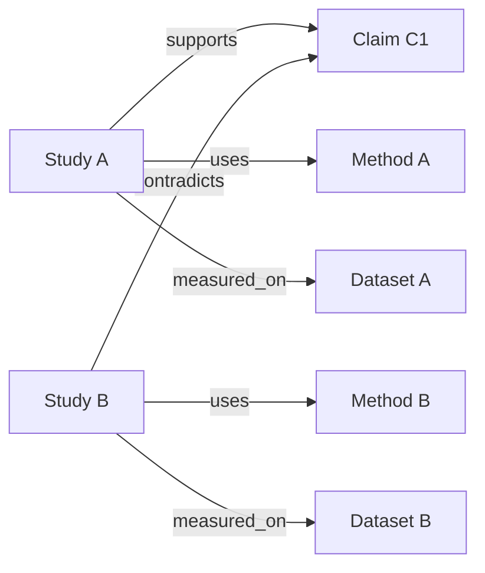

# Knowledge graph worked examples

[Collection index](README.md)

These examples are authored designs for a test project named `graph-lab`.
They are not extracted customer data.
The examples use existing Markdown syntax and retrieval interfaces.
Exact algorithms appear separately from model interpretation.

## Example 1: requirement, decision, and verification

### Question

Which requirement does a design satisfy, why was the design chosen, and what verifies it?

### Notes

Create these notes in one project.
Each block represents a separate Markdown file.

```markdown
---
title: R1 Duplicate Delivery
type: requirement
permalink: requirements/r1-duplicate-delivery
---

# R1 Duplicate Delivery

- [requirement] Process each accepted message at most once.
```

```markdown
---
title: D1 Idempotency Key
type: decision
permalink: decisions/d1-idempotency-key
status: accepted
---

# D1 Idempotency Key

- [decision] Use a stable key for each logical message.
- [reason] Retries can deliver the same message more than once.

## Relations

- satisfies [[R1 Duplicate Delivery]]
- justified_by [[E1 Retry Experiment]]
- applies_to [[Delivery Worker]]
```

```markdown
---
title: E1 Retry Experiment
type: evidence
permalink: evidence/e1-retry-experiment
---

# E1 Retry Experiment

- [setup] Retry 100 logical messages three times each.
- [result] The test fixture records 100 accepted processing events.
- [limit] This synthetic result covers the stated fixture only.
```

```markdown
---
title: T1 Duplicate Delivery Test
type: verification
permalink: verification/t1-duplicate-delivery
status: passed
---

# T1 Duplicate Delivery Test

- [result] The supplied fixture passed its duplicate-delivery check.

## Relations

- verifies [[R1 Duplicate Delivery]]
- exercises [[Delivery Worker]]
- supported_by [[E1 Retry Experiment]]
```

```markdown
---
title: Delivery Worker
type: component
permalink: components/delivery-worker
---

# Delivery Worker

- [function] Accept messages and record processing outcomes.
```

The experiment and test outcomes are synthetic example statements.
They do not assert that the repository implements or tested this delivery system.

### Prompt

> Explain how D1 addresses R1. Read the experiment and verification notes.
> Show the directed relation paths. Separate the design rationale from the recorded test result.
> State the fixture limit.

### Retrieval sequence

1. Find R1 through its exact identifier.
2. Retrieve a compact neighborhood at depth two.
3. Read D1, E1, and T1 directly.
4. Preserve the direction of `satisfies`, `justified_by`, and `verifies`.
5. Cite the source notes in the explanation.

```python
bm_context(
    identifier="requirements/r1-duplicate-delivery",
    project="graph-lab",
    depth=2,
    since="10 years ago",
    max_related=100,
    compact=True,
    output_format="json",
)
```

### Expected interpretation

D1 points to R1 through `satisfies`.
D1 points to E1 through `justified_by`.
T1 points to R1 through `verifies`.
The graph supplies explicit traceability. The note bodies supply the evidence and its limits.

A neighborhood can contain unrelated labels and incoming links.
A complete coverage report needs an exact graph query and a known requirement inventory.

### A schema that supports the convention

```yaml
---
title: Decision Structure
type: schema
entity: decision
schema:
  decision: string
  reason: string
  satisfies?(array): Requirement
  justified_by?(array): Evidence
---
```

This schema can check the presence of the named fields.
It does not establish target type correctness or evidence quality.
Add those checks in the harness if they are required.

## Example 2: claims, support, and contradiction

### Question

Why do two sources disagree about one research claim?

### Proposed graph



### Important modeling choice

Create Claim C1 as its own note.
A free-text observation has weaker independent identity than a claim note.
A claim note can hold review status, scope, source links, and its own evidence relations.

```markdown
---
title: Claim C1 Cache Improves Throughput
type: claim
permalink: claims/c1-cache-throughput
status: disputed
---

# Claim C1 Cache Improves Throughput

- [claim] A cache improves throughput under the stated workload.
- [scope] The claim concerns the measured workload and configuration.
```

```markdown
---
title: Study A Cache Trial
type: study
permalink: studies/a-cache-trial
---

# Study A Cache Trial

- [result] The supplied example records higher throughput after caching.
- [limit] The workload contains repeated reads.

## Relations

- supports [[Claim C1 Cache Improves Throughput]]
- uses [[Method A Repeated Reads]]
- measured_on [[Dataset A Repeated Requests]]
```

A second study can use `contradicts` and describe a workload dominated by writes.
The linked claim can remain disputed until a reviewer narrows its scope.
The system should not delete either source merely because the findings disagree.

### Prompt

> Compare support and contradiction paths for Claim C1. Read the linked method and dataset notes.
> Explain whether the sources test the same scope. Mark any new reconciliation as an inference.

### Required added logic

A contradiction review service can collect claims that share subject and scope.
It can then compare predicates, values, time intervals, and source conditions.
Basic Memory does not implement that full semantic comparison in its graph engine.

For an important edge, create a **relation claim note**.
This means a note that represents a relationship assertion as an entity.
That note can point to the subject, object, and evidence through named relations.

```markdown
---
title: RC1 Study A Supports C1
type: relation_claim
permalink: relation-claims/rc1
review_status: proposed
---

# RC1 Study A Supports C1

- [predicate] supports
- [scope] Repeated-read workload only.

## Relations

- subject [[Study A Cache Trial]]
- object [[Claim C1 Cache Improves Throughput]]
- supported_by [[Study A Cache Trial]]
```

This design adds provenance and review state to an otherwise lightweight edge.
It is a proposed convention. The core does not give this note special inference semantics.

## Example 3: exact dependency impact

### Question

Which components depend directly or indirectly on Storage?

### Fixture

| Source | Relation | Target |
| --- | --- | --- |
| API | `depends_on` | Queue |
| Worker | `depends_on` | Queue |
| Queue | `depends_on` | Storage |
| API | `documented_in` | API Guide |
| Monitor | `observes` | Storage |

The exact dependency answer is Queue, API, and Worker.
Monitor is related to Storage, but its edge does not say `depends_on`.
A generic neighborhood can include Monitor.
An impact query must filter the edge label and traverse the correct direction.

### Graph retrieval

```http
GET /v2/projects/<project-uuid>/knowledge/graph
```

The exported node identities are external UUIDs.
Map display names to those identities before analysis.
Do not assume that a title is unique.

### Added deterministic algorithm

This Python function consumes the exported `nodes` and `edges` shape.
It requires only the standard library.
The function runs in the proposed analysis layer, outside Basic Memory.

```python
from collections import defaultdict, deque


def dependents(graph, target_id, relation_type="depends_on"):
    reverse = defaultdict(set)
    for edge in graph["edges"]:
        if edge["relation_type"] == relation_type:
            reverse[edge["to_id"]].add(edge["from_id"])

    seen = {target_id}
    queue = deque([target_id])
    result = []
    while queue:
        current = queue.popleft()
        for source_id in sorted(reverse[current]):
            if source_id in seen:
                continue
            seen.add(source_id)
            queue.append(source_id)
            result.append(source_id)
    return result
```

The `seen` set handles cycles.
The source system still needs to provide a complete dependency inventory.
An unresolved dependency is absent from the resolved graph export.

### Prompt

> Use the exported snapshot to compute reverse `depends_on` closure from Storage.
> Explain the returned paths in plain language. Exclude `observes` and `documented_in` edges.
> Report unresolved references and snapshot limits separately.

### Expected evaluation

- Include Queue, API, and Worker.
- Exclude Monitor and API Guide.
- Return each component once.
- Preserve behavior if API and Queue form a cycle.
- Report an incomplete source inventory instead of claiming a complete system impact analysis.

## Example 4: task graph and durable handoff

### Proposed note types

| Type | Useful metadata | Useful relations |
| --- | --- | --- |
| `task` | status, priority, owner, review date | `blocked_by`, `advances`, `implements` |
| `decision` | status, scope, review status | `applies_to`, `justified_by`, `supersedes` |
| `coding_session` | repository, branch, SHA, verification summary | `continues`, `advances`, `records` |
| `evidence` | source identity, captured time, result | `verifies`, `produced_by` |

### Example task

```markdown
---
title: Task Migrate Queue Client
type: task
permalink: tasks/migrate-queue-client
status: blocked
priority: high
---

# Task Migrate Queue Client

- [goal] Replace the retired queue client.
- [next_action] Confirm the new retry behavior against the approved fixture.

## Relations

- blocked_by [[Task Verify Retry Semantics]]
- implements [[D1 Idempotency Key]]
- affects [[Delivery Worker]]
```

### Prompt

> Resume Task Migrate Queue Client. Read its blockers, latest checkpoint, and related decisions.
> Compare remembered repository state against live state. Propose one next action.

### Harness responsibility

The harness verifies the live repository and task state.
An external execution ledger owns leases, retries, and worker assignment.
Basic Memory stores the readable plan, decisions, evidence, and checkpoints.
A `blocked_by` link alone does not lock a task or dispatch a worker.

Existing host packages provide much of the recall and checkpoint pattern.
The execution policy remains new work.

## Example 5: prerequisite graph for a study plan

### Fixture

```text
Distributed Transactions -> requires -> Concurrency
Concurrency -> requires -> State Machines
Retry Safety -> requires -> Idempotency
Distributed Transactions -> requires -> Retry Safety
```

### Prompt

> Build a prerequisite plan for Distributed Transactions. Use explicit `requires` links.
> Report cycles and unresolved topics. Explain which notes support each prerequisite.

### Added analysis

A prerequisite closure identifies the required topics.
A topological sort produces a valid order if the graph has no cycle.
A selection policy can then account for the learner's stated prior knowledge.

A generic graph neighborhood cannot guarantee that order.
Semantic similarity can suggest missing prerequisites, but those suggestions require review before acceptance.

## Common implementation rules

1. Use one project for the first prototype.
2. Create stable note identities before importing many relations.
3. Keep one relation label for each domain concept.
4. Keep source evidence separate from derived interpretations.
5. Validate expected fields explicitly.
6. Inspect unresolved targets before a completeness claim.
7. Record the graph snapshot for exact analysis.
8. Read selected note content after compact discovery.
9. Use a revision checksum for edits.
10. Verify current external state before resuming action.

## Source support

- Parser and relation syntax: [src/basic_memory/markdown/plugins.py](https://github.com/basicmachines-co/basic-memory/blob/14ed21b9eaf892b7774c346898981b355fc92dbe/src/basic_memory/markdown/plugins.py).
- Graph storage and source ownership: [src/basic_memory/models/knowledge.py](https://github.com/basicmachines-co/basic-memory/blob/14ed21b9eaf892b7774c346898981b355fc92dbe/src/basic_memory/models/knowledge.py).
- Context traversal and bounds: [src/basic_memory/services/context_service.py](https://github.com/basicmachines-co/basic-memory/blob/14ed21b9eaf892b7774c346898981b355fc92dbe/src/basic_memory/services/context_service.py).
- Graph response shape: [src/basic_memory/schemas/v2/graph.py](https://github.com/basicmachines-co/basic-memory/blob/14ed21b9eaf892b7774c346898981b355fc92dbe/src/basic_memory/schemas/v2/graph.py).
- Graph export: [src/basic_memory/api/v2/routers/knowledge_router.py](https://github.com/basicmachines-co/basic-memory/blob/14ed21b9eaf892b7774c346898981b355fc92dbe/src/basic_memory/api/v2/routers/knowledge_router.py#L188).
- Validation limits: [src/basic_memory/picoschema/validator.py](https://github.com/basicmachines-co/basic-memory/blob/14ed21b9eaf892b7774c346898981b355fc92dbe/src/basic_memory/picoschema/validator.py).
- Existing continuity patterns: [plugins/codex/README.md](https://github.com/basicmachines-co/basic-memory/blob/14ed21b9eaf892b7774c346898981b355fc92dbe/plugins/codex/README.md) and [integrations/shared/README.md](https://github.com/basicmachines-co/basic-memory/blob/14ed21b9eaf892b7774c346898981b355fc92dbe/integrations/shared/README.md).
