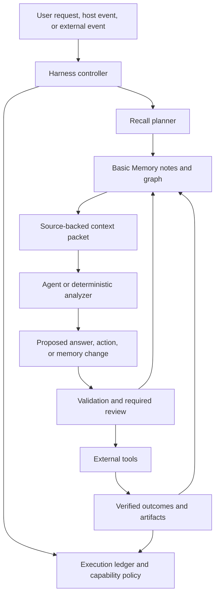

# Harness systems built on Basic Memory

[Collection index](README.md)

This chapter proposes **32 harness systems**.
A harness controls when an agent runs, which tools it uses, and what context it receives.
Basic Memory supplies durable knowledge and retrieval primitives.
The proposed harness supplies execution control and the additional logic named below.

## A common architecture

The ledger owns machine execution state.
Basic Memory owns readable task knowledge, decisions, evidence, and checkpoints.
A host can combine these concerns in one deployment, but the contracts must remain clear.

## System catalog

### Continuity and context harnesses

| ID | Harness | Trigger | Reads from memory | Control loop and durable output | Added system |
| --- | --- | --- | --- | --- | --- |
| H01 | Repository resume assistant | New or resumed coding session | Tasks, decisions, checkpoints, repository identity | Verify live state, choose context, then save a new checkpoint | Git adapter and context selection policy |
| H02 | Cross-host handoff bridge | A user changes agent host | Shared checkpoints and typed work records | Translate host context and preserve authoritative pointers | Versioned handoff contract and host conformance tests |
| H03 | Personal context router | A request spans several knowledge areas | Project metadata and relevant note neighborhoods | Select permitted projects and prepare a bounded context packet | Explicit routing and access policy |
| H04 | Memory budget compiler | The task exceeds its context budget | Candidate notes, edge paths, source revisions | Select evidence under a token budget and record omissions | Budget optimizer and answer coverage model |

### Evidence and research harnesses

| ID | Harness | Trigger | Reads from memory | Control loop and durable output | Added system |
| --- | --- | --- | --- | --- | --- |
| H05 | Claim evidence assistant | A user asks why a claim is believed | Claims, source notes, support and contradiction links | Read evidence, compare scope, and return cited paths | Citation viewer and claim review rules |
| H06 | Literature survey controller | A topic or paper set is supplied | Papers, methods, datasets, results, and open questions | Retrieve sources, normalize records, compare evidence, propose gaps | Search connector and extraction review |
| H07 | Experiment planner | A decision depends on unresolved assumptions | Assumptions, prior experiments, constraints, and decisions | Choose a useful next experiment and retain its rationale | Planner and external experiment runner |
| H08 | Reproducibility controller | A result needs verification | Run, configuration, data version, code version, and result notes | Check artifacts, run approved verification, and store evidence | Artifact store and isolated execution environment |

### Engineering delivery harnesses

| ID | Harness | Trigger | Reads from memory | Control loop and durable output | Added system |
| --- | --- | --- | --- | --- | --- |
| H09 | Requirement verification controller | A change or release needs review | Requirements, design decisions, changes, and tests | Compute coverage and prepare a review packet | Exact graph analysis and CI connector |
| H10 | Dependency impact assistant | A component or API will change | Typed dependencies and ownership notes | Compute reverse closure and prepare migration tasks | Code graph adapter and closure algorithm |
| H11 | Release knowledge controller | A delivery milestone completes | Changes, issues, decisions, evidence, and release notes | Collect delivery facts and publish reviewed project memory | CI integration and idempotent publication |
| H12 | Architecture review assistant | A proposal changes system structure | Components, interfaces, patterns, constraints, and decisions | Compare recorded rules and prepare questions with paths | Design review policy and source-code mapping |

### Task and worker coordination harnesses

| ID | Harness | Trigger | Reads from memory | Control loop and durable output | Added system |
| --- | --- | --- | --- | --- | --- |
| H13 | Durable task controller | A long task spans sessions | Task graph, decisions, evidence, and checkpoints | Dispatch ready work and persist readable progress | External scheduler, leases, retries, and cancellation |
| H14 | Multi-agent work coordinator | Several workers share one objective | Task dependencies, ownership notes, and artifact references | Assign isolated work, collect evidence, and resolve handoffs | Atomic execution ledger and conflict protocol |
| H15 | Human review queue | A candidate memory change needs review | Proposed notes, source revisions, and decision records | Present a diff and apply accepted changes under checksums | Review interface and batch recovery |
| H16 | Constraint-aware planner | An objective has prerequisite and resource limits | Task graph, constraints, and alternative decisions | Search feasible plans and explain rejected paths | Planning algorithm and resource state |

### Knowledge maintenance harnesses

| ID | Harness | Trigger | Reads from memory | Control loop and durable output | Added system |
| --- | --- | --- | --- | --- | --- |
| H17 | Graph quality inspector | A user requests a corpus health report | Relations, aliases, orphans, schemas, and source notes | Report defects and prepare reversible repair proposals | Graph linter and mutation plan executor |
| H18 | Reflection worker | A scheduled or manual reflection event | Recent captures, tasks, decisions, and concept notes | Propose durable lessons in their proper note locations | External schedule and promotion policy |
| H19 | Contradiction review assistant | New evidence conflicts with accepted memory | Claim notes, qualifiers, support, and review status | Preserve both sources and request a scoped resolution | Contradiction detector and reviewer workflow |
| H20 | Freshness and invalidation worker | A source changes or a review expires | Source manifests and downstream dependency paths | Mark derived knowledge for review and prepare refresh tasks | Change consumer, dependency index, and scheduler |

### Domain workflow harnesses

| ID | Harness | Trigger | Reads from memory | Control loop and durable output | Added system |
| --- | --- | --- | --- | --- | --- |
| H21 | Incident learning assistant | An incident closes or an alert needs context | Incident, service, failure mode, mitigation, and runbook graph | Prepare response context or capture reviewed lessons | Incident connector and current-state verification |
| H22 | Product evidence assistant | A feature or roadmap choice needs support | Needs, interviews, assumptions, experiments, and objectives | Trace evidence and expose unsupported roadmap paths | Authorized feedback connector and source deduplication |
| H23 | Learning plan controller | A learner states a goal | Concept prerequisites, exercises, and review records | Build a plan and revise it from recorded progress | Curriculum algorithm and learner-controlled schedule |
| H24 | Data lineage assistant | A data definition or schema changes | Dataset, column, transform, metric, owner, and policy graph | Explain lineage and compute affected downstream resources | Catalog connector and exact graph queries |

### Execution and tool-use harnesses

| ID | Harness | Trigger | Reads from memory | Control loop and durable output | Added system |
| --- | --- | --- | --- | --- | --- |
| H25 | Runbook execution assistant | An operator requests a bounded procedure | Approved runbook, system context, and prior evidence | Verify preconditions, execute allowed steps, record outcomes | Tool permissions, live telemetry, and action gates |
| H26 | Agent evaluation controller | A memory policy or tool contract changes | Cases, expected answers, source graphs, and run results | Run comparisons and retain failures with retrieval traces | Isolated runner and scoring framework |
| H27 | Agent lesson library | Repeated tool-use failures appear | Failure notes, remedies, tools, and evidence | Retrieve relevant lessons before a tool step | Validated lesson selection and expiry policy |
| H28 | Scenario simulation controller | A user explores an alternative plan | Assumptions, scenario notes, decisions, and constraints | Run a simulation and store hypothetical results separately | Simulator and strict scenario namespace |

### Interchange and governance harnesses

| ID | Harness | Trigger | Reads from memory | Control loop and durable output | Added system |
| --- | --- | --- | --- | --- | --- |
| H29 | Portable knowledge publisher | A project needs a reviewed export | Notes, links, sources, generated navigation, and history | Validate a bundle and publish to an explicit destination | Publisher and destination authorization |
| H30 | Team knowledge broker | Personal work contains a shareable lesson | Personal note, source evidence, team schema, and destination | Prepare attributed promotion and preserve source identity | Review workflow and workspace authorization |
| H31 | Federated retrieval broker | A question spans independent knowledge stores | Authorized project graphs and external source catalogs | Retrieve separately and combine cited evidence under scope | Connector policy and per-target authorization |
| H32 | Memory governance controller | A project needs retention or structure rules | Note types, status, review dates, evidence, and schema results | Report policy exceptions and prepare reviewable changes | Policy engine and audit store |

## Six high-value operating loops

### H01: repository resume assistant

1. Resolve the configured project and repository identity.
2. Retrieve active tasks, relevant decisions, and the chosen checkpoint.
3. Expand only the graph paths needed for the current objective.
4. Compare branch, commit, changed files, and external artifacts against live state.
5. Present verified state and one primary next action.
6. Save a new checkpoint after meaningful work.

Example prompt:

> Resume the queue migration from its latest verified checkpoint.
> Read blocking decisions and evidence. Compare the recorded repository state against the live checkout.

The existing Codex and Claude Code packages already cover parts of this loop.
A new product should improve graph selection, coverage, or evidence verification.

### H05: claim evidence assistant

1. Resolve the claim identity.
2. Collect support, contradiction, method, and scope paths.
3. Read the source content and available document locators.
4. Compare evidence conditions and source versions.
5. Return an explanation with paths and unresolved questions.
6. Store a reviewed analysis only when the workflow requires a durable result.

Example prompt:

> Explain the evidence for claim C1. Compare supporting and conflicting sources.
> State the scope of each source and identify any unsupported inference.

### H09: requirement verification controller

1. Capture an explicit requirement inventory and graph snapshot.
2. Compute required design and verification paths.
3. Read missing, conflicting, and failed-result cases.
4. Compare the graph against CI evidence.
5. Produce a coverage report tied to the snapshot.
6. Create follow-up tasks for reviewed gaps.

Example prompt:

> Check release R against its requirement graph. Return every missing verification path and its source evidence.

The analyzer must distinguish an absent relation from an unresolved relation.
A green test result does not prove that every requirement has a test.

### H14: multi-agent work coordinator

1. Convert the objective into readable task notes and explicit dependencies.
2. Store atomic claims and worker leases in an execution ledger.
3. Give each worker a bounded graph context and explicit output contract.
4. Collect artifacts and verification evidence.
5. Review conflicts before updating shared knowledge.
6. Save a handoff checkpoint when a worker stops.

Example prompt:

> Divide this approved objective into independent work items.
> Use the task graph for dependencies and the execution ledger for worker ownership.

A Markdown status field cannot provide an atomic worker lease.
Concurrent read-then-write task claims need an external coordination mechanism.

### H18: reflection worker

1. Select a settled range of recent changes.
2. Read raw captures and their related durable notes.
3. Identify lessons that remain useful beyond the session.
4. Prepare source-backed updates and duplicate checks.
5. Validate the proposed notes and apply the configured review policy.
6. Record source revisions and the routine result.

Example prompt:

> Review today's captures. Propose durable lessons for existing topic notes.
> Keep uncertain claims and unresolved contradictions in a review queue.

Existing `memory-reflect`, `memory-curate`, and `memory-defrag` skills provide workflow guidance.
The proposed harness adds a durable trigger, run identity, idempotency, and evaluation.

### H26: agent evaluation controller

1. Freeze a corpus, graph, query set, and expected result set.
2. Run the baseline policy.
3. Run the proposed policy under the same limits.
4. Score evidence correctness, recall, latency, and mutation errors.
5. Retain failing traces and source snapshots.
6. Promote a policy only after its acceptance criteria pass.

Example prompt:

> Compare the baseline and graph-aware resume policies on the fixed task set.
> Report evidence accuracy, missing constraints, token use, and recovery failures.

The current benchmark files provide starting material.
A new harness still needs its own task-specific expected results.

## Which systems need an LLM?

| Function | Recommended implementation |
| --- | --- |
| Exact UUID lookup, relation filtering, closure, cycles, and schema presence checks | Deterministic code. |
| Selecting useful candidate notes from a natural-language request | Retrieval policy, with optional model assistance. |
| Comparing reasons, summarizing evidence, and drafting a handoff | Model plus cited source reads. |
| Authorizing access and mutating protected destinations | Enforced policy outside prompt text. |
| Atomic claims, retries, cancellation, and scheduling | Workflow engine or transactional execution service. |
| Accepting a new causal relation or entity merge | Explicit review policy and source evidence. |

## Existing foundation

- Host lifecycle and checkpoints: [plugins/claude-code/README.md](https://github.com/basicmachines-co/basic-memory/blob/14ed21b9eaf892b7774c346898981b355fc92dbe/plugins/claude-code/README.md) and [plugins/codex/README.md](https://github.com/basicmachines-co/basic-memory/blob/14ed21b9eaf892b7774c346898981b355fc92dbe/plugins/codex/README.md).
- Additional host memory runtimes: [integrations/](https://github.com/basicmachines-co/basic-memory/tree/14ed21b9eaf892b7774c346898981b355fc92dbe/integrations/).
- Task, schema, reflection, and curation procedures: [skills/](https://github.com/basicmachines-co/basic-memory/tree/14ed21b9eaf892b7774c346898981b355fc92dbe/skills/).
- Portable mutation and workflow contracts: [src/basic_memory/runtime/](https://github.com/basicmachines-co/basic-memory/tree/14ed21b9eaf892b7774c346898981b355fc92dbe/src/basic_memory/runtime/).
- Graph context and export: [src/basic_memory/services/context_service.py](https://github.com/basicmachines-co/basic-memory/blob/14ed21b9eaf892b7774c346898981b355fc92dbe/src/basic_memory/services/context_service.py) and [src/basic_memory/api/v2/routers/knowledge_router.py](https://github.com/basicmachines-co/basic-memory/blob/14ed21b9eaf892b7774c346898981b355fc92dbe/src/basic_memory/api/v2/routers/knowledge_router.py#L188).

See [the reference design](13-reference-harness-design.md) for concrete data contracts, state transitions, and failure handling.
