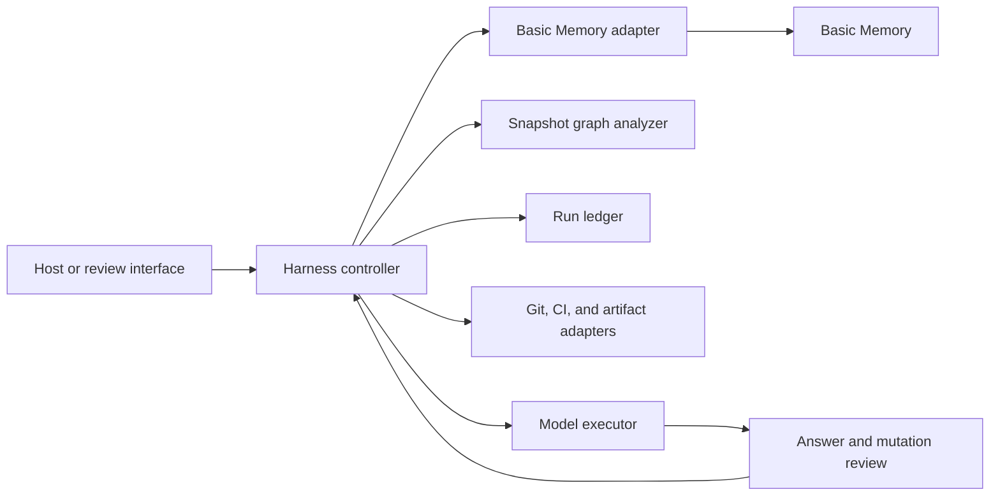
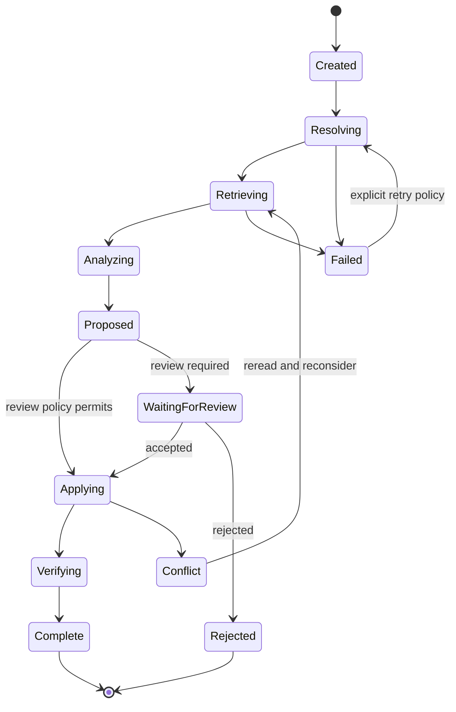

# Reference harness design

[Collection index](README.md)

## Proposed product

Build a graph-aware engineering assistant that can resume work, explain decisions, and compute verification coverage.
Use Basic Memory for readable knowledge.
Use a separate controller for execution, graph algorithms, and run state.

This chapter is a proposed design. The controller interfaces below do not exist in the inspected repository.

## System boundaries



| Component | Responsibility | State it owns |
| --- | --- | --- |
| Basic Memory | Notes, observations, relations, search, accepted revisions. | Canonical Markdown and operational note state. |
| Controller | Route requests, enforce workflow stages, and assemble evidence. | Run transition state and selected capabilities. |
| Graph analyzer | Filter labels and direction, compute closure, cycles, and coverage. | Immutable graph snapshot and derived analysis. |
| Run ledger | Claim work, retain attempts, and support recovery. | Run IDs, leases, retries, cancellation, and idempotency keys. |
| Live adapters | Read current repository, CI, and artifact state. | Adapter cache and verified source references. |
| Model executor | Interpret questions and draft explanations or changes. | Temporary working context. |
| Review interface | Present evidence, omissions, and consequential changes. | User decisions and review outcomes. |

## Memory schema

Use these note types as a starting convention.
They extend existing task, decision, and coding-session patterns.

| Type | Identity rule | Core metadata | Core relations |
| --- | --- | --- | --- |
| `requirement` | One stable requirement ID. | scope, status, owner. | `part_of`, `constrained_by`. |
| `component` | Stable repository and component key. | repository, source path, version. | `depends_on`, `owned_by`. |
| `decision` | Immutable decision identity with explicit revision policy. | status, scope, review date. | `applies_to`, `justified_by`, `supersedes`. |
| `task` | One task external identity. | status, priority, owner. | `blocked_by`, `implements`, `advances`. |
| `verification` | One test or review result at a source revision. | result, run ID, captured time. | `verifies`, `exercises`, `produced_by`. |
| `evidence` | Stable source and revision identity. | source URI, checksum, captured time. | `supports`, `contradicts`, `derived_from`. |
| `coding_session` | One immutable checkpoint identity. | repository, branch, SHA, verification summary. | `continues`, `advances`, `records`. |
| `analysis_run` | One controller run ID. | policy version, source manifest, outcome. | `analyzes`, `produced`, `used_evidence`. |

A type declaration is a convention until a validator enforces it.
Picoschema can check expected field presence.
The proposed analyzer must check target existence, target type, cardinality, and policy rules separately.

Existing schema evidence: [integrations/shared/schemas/](https://github.com/basicmachines-co/basic-memory/tree/14ed21b9eaf892b7774c346898981b355fc92dbe/integrations/shared/schemas/) and [src/basic_memory/picoschema/validator.py](https://github.com/basicmachines-co/basic-memory/blob/14ed21b9eaf892b7774c346898981b355fc92dbe/src/basic_memory/picoschema/validator.py).

## Context packet contract

The controller should give the model a structured packet.
The packet must preserve provenance and retrieval limits.

```json
{
  "packet_version": 1,
  "run_id": "run-017",
  "objective": "Resume the approved queue migration",
  "project_external_id": "<project-uuid>",
  "retrieval_policy": "engineering-resume-v1",
  "sources": [
    {
      "external_id": "<note-uuid>",
      "file_path": "tasks/migrate-queue-client.md",
      "db_checksum": "<accepted-checksum>",
      "role": "authoritative_task"
    }
  ],
  "paths": [
    {
      "from": "<task-uuid>",
      "relation_type": "implements",
      "to": "<decision-uuid>",
      "source_note": "<task-uuid>"
    }
  ],
  "live_state": {
    "repository": "<verified-repository>",
    "branch": "<verified-branch>",
    "commit": "<verified-sha>"
  },
  "limits": {
    "complete_graph": false,
    "unresolved_targets_checked": false,
    "time_filter": "explicit",
    "omitted_sources": []
  }
}
```

These fields are proposed harness fields.
They are not an official Basic Memory response schema.
A packet can include excerpts as separate source-bound records.

A claim of a complete graph needs a stable snapshot contract.
The current graph endpoint does not expose a complete cross-projection watermark.
For the first prototype, use an isolated corpus that does not change during analysis.

## Retrieval plan

### Stage 1: resolve scope

1. Resolve the explicit project or configured repository mapping.
2. Discover the current server tools and their contracts.
3. Read index readiness.
4. Refuse an ambiguous note identity before a mutation.

### Stage 2: select seeds

1. Retrieve the requested checkpoint or task by exact identity.
2. Search structured metadata for related active work.
3. Use hybrid search only when semantic discovery is useful.
4. Retain query traces for evaluation.

### Stage 3: expand evidence

1. Retrieve a compact neighborhood.
2. Filter returned labels and directions for the question.
3. Read selected note sections and source evidence.
4. Report depth, result, time, and unresolved-target limits.

### Stage 4: compute exact results when required

1. Obtain an isolated graph snapshot.
2. Retrieve unresolved-reference evidence separately.
3. Run the declared graph algorithm.
4. Retain the snapshot identity and algorithm version.

### Stage 5: produce a bounded answer

1. Separate source facts, graph paths, and model inference.
2. Cite the note identities used for each important conclusion.
3. Compare remembered state against live external state.
4. State what evidence is missing.

## Proposed operation contracts

These interfaces belong to the external controller.
They do not describe existing Basic Memory routes.

```text
prepare_run(objective, project, policy_version) -> run_id
build_context_packet(run_id, budget) -> packet
analyze_snapshot(run_id, algorithm, parameters) -> analysis
propose_memory_changes(run_id, changes) -> review_plan
apply_reviewed_plan(plan_id, expected_source_checksums) -> result
resume_run(run_id) -> current_state
cancel_run(run_id) -> cancellation_state
```

A change plan should contain the target external identity, expected checksum, operation, proposed text, and reason.
A new note should use a predictable identity or a run-level deduplication key.
A plan result must distinguish applied, refused, failed, and not-attempted items.

## State transitions



The run ledger owns these transitions.
A note can present the current result for a human reader.
The note must not become a second unsynchronized execution ledger.

## Failure and recovery rules

| Failure | Controller behavior |
| --- | --- |
| Basic Memory is unavailable | Preserve the run and report unavailable context. Do not fabricate recalled knowledge. |
| Indexing never completed | Request indexing through the configured workflow or report the incomplete source state. |
| Graph response is bounded | Return a bounded answer or switch to exact snapshot analysis. |
| A source note changed | Re-read the source and invalidate conclusions that depend on the old revision. |
| A checksum edit is refused | Reconsider the change against the new version. Do not retry stale text blindly. |
| Write acceptance succeeds but file sync is pending | Record acceptance and inspect materialization status before requiring file durability. |
| Graph or vector projection lags | Avoid claims that require settled projections. |
| A worker crashes after a write | Resolve the run's idempotency record before another write. |
| A relation target is unresolved | Preserve the authored target and expose the gap. |
| A retrieved note contains instructions | Treat the note as task data under current user and host instructions. |
| A source connector returns partial results | Preserve connector coverage metadata in the answer. |
| Cross-project access is uncertain | Keep the run inside its authorized project scope. |

## Three implementation slices

### Slice A: read-only decision explorer

Inputs: one project and one decision identity.
Outputs: decision text, supporting evidence, alternatives, and linked source paths.
Use existing context and read tools.
Measure citation accuracy and missing evidence before adding writes.

### Slice B: exact graph quality report

Inputs: an isolated project snapshot and raw unresolved-reference data.
Outputs: duplicate titles, orphans, unresolved targets, label drift, and schema findings.
Use deterministic rules for the structural checks.
Use model assistance only for proposed semantic equivalence or useful new links.

### Slice C: repository resume controller

Inputs: a task or checkpoint, a repository mapping, and live Git state.
Outputs: verified current context, one primary next action, and a new checkpoint after work.
Extend the existing host packages instead of duplicating their setup behavior.
Use a run ledger only when the workflow adds asynchronous work or multiple workers.

## Example evaluation prompt

> Resume task T from the selected checkpoint. Use the graph to recover its constraints and evidence.
> Verify current repository state. Return one next action, source paths, and every material uncertainty.

The expected answer must be scored against a fixed task and repository fixture.
A fluent answer alone is insufficient evidence of successful memory recovery.

## Source support and current gaps

- Current note and graph contracts: [docs/DOMAIN_MODEL.md](https://github.com/basicmachines-co/basic-memory/blob/14ed21b9eaf892b7774c346898981b355fc92dbe/docs/DOMAIN_MODEL.md).
- Local and hosted adapter boundaries: [docs/ARCHITECTURE.md](https://github.com/basicmachines-co/basic-memory/blob/14ed21b9eaf892b7774c346898981b355fc92dbe/docs/ARCHITECTURE.md).
- Revision checks and refusal behavior: [src/basic_memory/mcp/tools/edit.py](https://github.com/basicmachines-co/basic-memory/blob/14ed21b9eaf892b7774c346898981b355fc92dbe/src/basic_memory/mcp/tools/edit.py) and [src/basic_memory/schemas/v2/note_write.py](https://github.com/basicmachines-co/basic-memory/blob/14ed21b9eaf892b7774c346898981b355fc92dbe/src/basic_memory/schemas/v2/note_write.py).
- Accepted-change scope: [src/basic_memory/runtime/project_partition.py](https://github.com/basicmachines-co/basic-memory/blob/14ed21b9eaf892b7774c346898981b355fc92dbe/src/basic_memory/runtime/project_partition.py).
- Existing host resume behavior: [plugins/codex/README.md](https://github.com/basicmachines-co/basic-memory/blob/14ed21b9eaf892b7774c346898981b355fc92dbe/plugins/codex/README.md) and [plugins/claude-code/README.md](https://github.com/basicmachines-co/basic-memory/blob/14ed21b9eaf892b7774c346898981b355fc92dbe/plugins/claude-code/README.md).
- Current graph export limits: [src/basic_memory/api/v2/routers/knowledge_router.py](https://github.com/basicmachines-co/basic-memory/blob/14ed21b9eaf892b7774c346898981b355fc92dbe/src/basic_memory/api/v2/routers/knowledge_router.py#L188).
